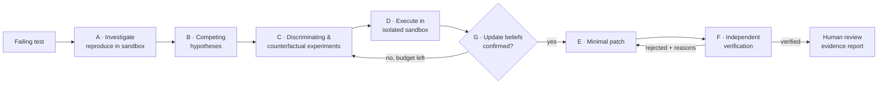

# FORGE-0

**Autonomous, evidence-driven software debugging.** FORGE-0 investigates a failing test the way a
careful engineer would. It generates competing root-cause hypotheses, designs experiments (including
counterfactual interventions) that discriminate between them, runs those experiments in an isolated
Docker sandbox, updates its beliefs from the results, and only then proposes a patch. An independent
verifier must accept that patch before a human ever sees it.

> **Current status (2026-10-19):** feature-complete in mock mode, CI green, waiting for Meta Model API
> access for the first real-model evaluation. See [docs/STATUS.md](docs/STATUS.md).
>
> Built for the Meta Global AI Developer Hackathon 2026, *Push the Frontier* theme, Indie Developer track.
> Model integration targets **Meta Muse Spark 1.3** via the Meta Model API. Until a key is configured,
> FORGE-0 runs on a clearly labelled **mock provider** with scripted outputs, while every execution
> and verification is still real.



## Status

| Area | Status |
| --- | --- |
| Seven-agent pipeline (A–G) with budgets, retries and termination | ✅ implemented, tested |
| Counterfactual experimentation engine + Bayesian hypothesis ranking | ✅ implemented, tested |
| Docker sandbox (no network, read-only, non-root, limits, timeouts, allowlisted runners) | ✅ implemented, isolation verified by integration tests |
| Independent verifier (fresh copies, full suite before/after, isolated target re-runs) | ✅ implemented, tested |
| FastAPI REST API + Server-Sent Events, PostgreSQL + Alembic | ✅ implemented, tested (SQLite in unit tests, PostgreSQL in integration) |
| React dashboard (dashboard, explorer, workspace, timeline, patch review, report, evaluation, settings) | ✅ implemented, verified in a browser |
| Mock provider (scripted, labelled *simulated*) | ✅ implemented |
| OpenAI-compatible provider | ✅ implemented, tested with a mock HTTP transport |
| Meta Model API provider (Muse Spark) | ✅ implemented to the documented contract · ⏳ **not yet run against the live API** (no key) |
| Demo service with 5 planted defects, reference fixes, hidden tests | ✅ implemented, validated in the sandbox |
| Baseline-vs-FORGE-0 evaluation harness + visual report | ✅ implemented · results so far are **mock-only** |
| CI (lint, typecheck, tests, builds, integration, gitleaks, dependency audit) | ✅ configured |
| Docker Compose full stack (`--profile app`) | ✅ built and exercised end to end, see [Docker](#docker-compose) |
| Lightweight dev mode for low-memory machines (`scripts/lite.ps1`) | ✅ implemented, measured (~105 MB vs ~391 MB host memory) |
| Real-model benchmark configuration (Muse Spark 1.3, 5 defects × 3 repeats) | ✅ prepared · ⏳ **waiting for API access** |
| Python repositories (pytest runner) | 🧪 experimental (image provided, not exercised end to end) |
| Multi-user auth, gVisor/VM isolation, dependency install inside sandbox | ⏳ planned |

## Quick start (Windows)

Requirements: Python 3.12+, Node.js 22.18+ (24 recommended), Git, and Docker Desktop **or** Docker
Engine inside WSL2.

```powershell
git clone https://github.com/waleedmustafa971/forge-0.git; cd forge-0
.\scripts\lite.ps1 start      # lightweight: one backend process serving API + dashboard on :8010
.\scripts\lite.ps1 stop       # stop everything
```

**Lite mode** (recommended on machines with ≤ 8 GB RAM) runs PostgreSQL (tuned, 256 MB cap) and a
single hidden backend that also serves the prebuilt dashboard at <http://127.0.0.1:8010>. No Vite and
no extra windows. See [docs/OPERATIONS.md](docs/OPERATIONS.md) for measurements and troubleshooting.

**Full mode** with frontend hot reload: `.\scripts\dev.ps1`. It creates `.env` from `.env.example`, starts PostgreSQL (`127.0.0.1:5433`) and, if Docker
runs inside WSL, a keep-alive session so the distro isn't stopped while idle. It then installs the
backend, runs the migrations, and opens the backend (<http://127.0.0.1:8010>, API docs at `/docs`) and
the frontend (<http://127.0.0.1:5173>) in their own windows. Stop with `.\scripts\stop.ps1`.

Linux/macOS: `./scripts/dev.sh`.

<details><summary>Manual setup</summary>

```bash
cp .env.example .env
docker compose up -d db                       # PostgreSQL on 127.0.0.1:5433
docker pull node:24-alpine                    # sandbox runtime

cd backend
python -m venv .venv && .venv/Scripts/activate   # (.venv/bin/activate on Linux/macOS)
pip install -e ".[dev]"
alembic upgrade head
uvicorn api.main:app --host 127.0.0.1 --port 8010

cd ../frontend
npm ci
npm run dev                                   # proxies /api to 127.0.0.1:8010
```

</details>

## Demonstration

See [docs/DEMO.md](docs/DEMO.md). In short: **Repositories → Run in sandbox** (14 pass / 5 fail),
then **New investigation** on any failing test. Watch hypotheses get refuted live, inspect the
counterfactual experiment, review the verified diff, and download the evidence report. The
double-charge defect shows the verifier rejecting a regression-causing patch and the repair being
revised.

## Evaluation

```powershell
backend\.venv\Scripts\python benchmarks\run_benchmark.py              # mock provider (benchmarks/configs/mock.json)
backend\.venv\Scripts\python scripts\audit_demo.py                     # 17 end-to-end checks of the double-charge demo
```

Real-model run, once `META_API_KEY` is set (a `--dry-run` spends no tokens; the real run requires `--yes`):

```powershell
backend\.venv\Scripts\python benchmarks\run_benchmark.py --config benchmarks\configs\muse-spark-1.3.json --dry-run
backend\.venv\Scripts\python benchmarks\run_benchmark.py --config benchmarks\configs\muse-spark-1.3.json --yes
```

Each claimed patch is applied to a fresh copy together with **hidden tests** neither system has
seen. Results land in `benchmarks/results/` (JSON + HTML) and on the **Evaluation** page.
Methodology, metric definitions and the current (mock-only) numbers are in
[docs/EVALUATION.md](docs/EVALUATION.md). Those numbers reflect scripted fixtures, not model
capability.

## Activating the Meta Model API

1. Add `META_API_KEY=…` to `.env` (git-ignored).
2. Set `AI_PROVIDER=meta` (or choose it in **Settings**).
3. Restart the backend.
4. `backend\.venv\Scripts\python scripts\check_meta.py --structured`
5. Start an investigation; the header shows `meta · muse-spark-1.3` instead of `MOCK · scripted`.

Details, the verified request contract and fallbacks: [docs/API_INTEGRATION.md](docs/API_INTEGRATION.md).

## Docker Compose

```bash
docker compose up -d db                         # just PostgreSQL (recommended for development)
docker compose --profile app up -d --build      # db + backend (:8010) + frontend (:8090)
```

The full-stack profile mounts the Docker socket into the **backend** container so it can launch
sandboxes. Read [docs/SECURITY.md](docs/SECURITY.md) before using it.

## Tests

| Suite | Command | Result (local, 2026-10-19) |
| --- | --- | --- |
| Backend unit + API | `cd backend && pytest -m "not docker and not postgres"` | 90 passed |
| Backend integration (real Docker + PostgreSQL) | `TEST_POSTGRES_URL=… pytest -m "docker or postgres"` | 11 passed |
| Frontend | `cd frontend && npm test` | 9 passed |
| Demo audit (running instance) | `python scripts/audit_demo.py` | 17/17 checks |
| GitHub Actions (all jobs, incl. gitleaks, pip-audit, npm audit) | run 39240489515 | passed |
| Lint / types | `ruff check`, `ruff format --check`, `npm run lint`, `npm run typecheck`, demo `tsc` | clean |
| Dependency audit | `pip-audit`, `npm audit --omit=dev` | no known vulnerabilities |

## Configuration

All settings are environment variables. See [.env.example](.env.example). Key ones:
`AI_PROVIDER` (`mock`|`meta`|`openai`), `META_API_KEY`, `META_MODEL`, `AI_MAX_TOKENS`,
`AI_TEMPERATURE`, `DATABASE_URL`, `SANDBOX_DOCKER_COMMAND` (`auto` finds `docker` or `wsl -- docker`),
`SANDBOX_MEMORY`/`SANDBOX_CPUS`/`SANDBOX_TIMEOUT_S`, and the budgets `MAX_EXPERIMENTS`,
`MAX_MODEL_CALLS`, `MAX_REPAIR_ATTEMPTS`, `INVESTIGATION_TIME_BUDGET_S`. Provider and budget choices
can also be changed at runtime in **Settings**. API keys can't: they never leave the backend.

## Documentation

* [Status and handoff](docs/STATUS.md): what is verified, what is not, steps when the Meta key arrives
* [Operations](docs/OPERATIONS.md): lite/full modes, memory measurements, shutdown, troubleshooting
* [Architecture](docs/ARCHITECTURE.md): agents, contracts, belief updates, verification, data model
* [API integration](docs/API_INTEGRATION.md): Meta Model API contract and activation
* [Security](docs/SECURITY.md): sandbox controls, threat model, limitations
* [Evaluation](docs/EVALUATION.md): methodology and results
* [Demo walkthrough](docs/DEMO.md) · [Defect catalog](demo/defects/README.md)
* [Hackathon submission draft + video script](docs/HACKATHON_SUBMISSION.md)
* [Contributing](CONTRIBUTING.md)

## Project layout

```text
backend/     FastAPI · agents/ · api/ · core/ · providers/ · sandbox/ · services/ · alembic/ · tests/
frontend/    React + TypeScript + Vite dashboard
demo/        order-management (investigation target) · defects/ (catalog + reference fixes)
benchmarks/  run_benchmark.py · configs/ · hidden-tests/ · results/
docs/        architecture, integration, security, evaluation, demo, submission
scripts/     lite.ps1 · dev.ps1 · dev.sh · stop.ps1 · measure_memory.ps1 · audit_demo.py · check_meta.py
```

## License

[MIT](LICENSE)
