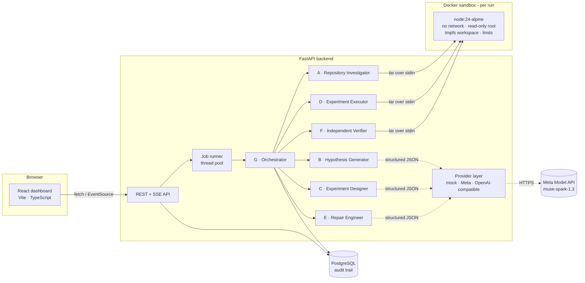
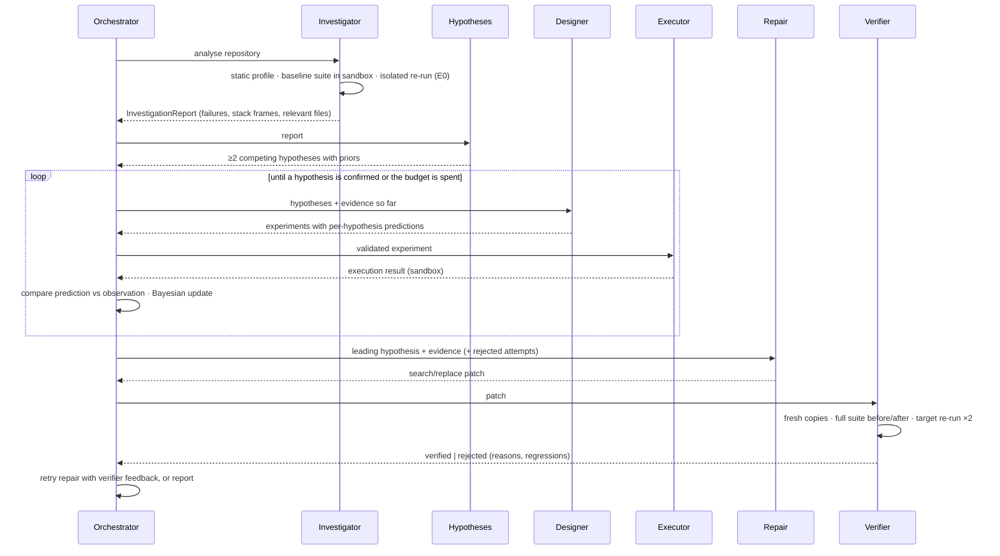

# FORGE-0 Architecture

FORGE-0 investigates software defects the way a careful engineer does: it observes the failure,
proposes *competing* explanations, designs experiments whose outcomes differ depending on which
explanation is true, runs them in isolation, updates its beliefs from the evidence, and only then
writes a repair, which an independent verifier must accept before it is offered to a human.

## System overview



## Investigation lifecycle



## Agents

| Agent | Kind | Responsibility | Code |
| --- | --- | --- | --- |
| **A · Repository Investigator** | deterministic | Languages, frameworks, dependencies, test runner detection; baseline suite run; TAP parsing; target failure + stack frames; isolated reproduction (E0); relevant-file collection through the import graph | `backend/agents/investigator.py`, `services/repo_analysis.py` |
| **B · Hypothesis Generator** | model | 2–5 mutually exclusive explanations with mechanism, locations, supporting/contradicting evidence and priors; enforces ≥2 competitors | `agents/hypothesis.py` |
| **C · Experiment Designer** | model + validator | Discriminating experiments: new test files and/or counterfactual source interventions, with a prediction per hypothesis; every design is validated against the sandbox contract before execution | `agents/experiment_designer.py` |
| **D · Experiment Executor** | deterministic | Materialises the experiment in a disposable copy, runs it in Docker, classifies pass/fail/error/timeout, retries infrastructure failures once | `agents/executor.py`, `sandbox/` |
| **E · Repair Engineer** | model | Minimal search/replace patch for the leading hypothesis; may not touch tests; receives verifier feedback on retries | `agents/repair.py` |
| **F · Independent Verifier** | deterministic | Re-applies the stored edits to a fresh copy, runs the full suite on original and patched code, re-runs the target twice in isolation, diffs results test-by-test | `agents/verifier.py` |
| **G · Orchestrator** | deterministic | State machine, budgets (time, model calls, experiments, rounds, repair attempts), belief updates, persistence, decisions, final report | `agents/orchestrator.py`, `agents/belief.py` |

Model-facing agents communicate exclusively through Pydantic contracts (`core/schemas.py`):
`HypothesisSet`, `ExperimentPlan`/`ExperimentDraft`/`Prediction`, `PatchDraft`. Deterministic agents
produce `InvestigationReport`, `ExecutionResult`, `TestRunSummary` and `VerificationReport`.

## Counterfactual debugging engine

Each hypothesis starts with the model's prior, rescaled so that an explicit **unexplained** bucket
keeps 10% of the probability mass. Every executed experiment carries predictions written *before*
it ran — e.g. *"if H2 is true, routing the reservation through `tx` makes the original test pass"*.
After execution (`agents/belief.py`):

* prediction matched → likelihood 0.9; contradicted → 0.1; no prediction → 0.5;
* posteriors are renormalised (including the unexplained bucket);
* a hypothesis is **refuted** when it has been contradicted and falls below 10%;
* it is **confirmed** only at ≥75% with at least one *discriminating* supporting experiment and no
  contradictions — an experiment where every hypothesis predicts the same thing cannot confirm anything;
* errors and timeouts carry no evidence.

Experimentation stops when a hypothesis is confirmed, the designer reports nothing informative is
left, or the experiment/round/time budget is exhausted. Below 50% confidence without confirmation,
the investigation ends **inconclusive** and no patch is attempted.

Experiment kinds:

* **reproduction** — the investigator's control run (E0);
* **discrimination** — new probe tests that isolate one component;
* **intervention** — counterfactual edits applied only to a disposable copy, then the original
  failing test is re-run ("would the failure disappear if…?").

## Verification contract

A patch is **verified** only if, on fresh copies made from the immutable snapshot:

1. it applies cleanly and touches no test files;
2. the target test passes in the full suite **and** in two isolated re-runs;
3. no test that passed on the original code fails or disappears;
4. the patched suite produced a parseable report and did not time out.

Anything else is **rejected** with reasons, and the reasons are fed back to the Repair Engineer.
Patches are never applied to the user's repository; the UI offers review (approve/reject) and a
`.patch` download.

## Persistence and audit trail

PostgreSQL (SQLite for tests) stores `repositories`, `investigations`, `events` (append-only audit
log streamed to the UI over SSE), `hypotheses` (with per-experiment belief history), `experiments`
(spec, predictions, raw execution result, evaluation), `patches` (edits, unified diff, verification),
`model_calls` (provider, model, tokens, latency, simulated flag) and `app_settings`. Schema changes
go through Alembic (`backend/alembic/versions`).

## Provider layer

`providers/base.py` defines `AIProvider.generate(request, schema)`; every agent request carries both
rendered prompts (for real models) and structured context (for the mock).

* **MockProvider** — scripted fixtures for the five demo defects, generic non-diagnostic output
  otherwise (never a fabricated patch). Every completion is flagged `simulated`, token counts are
  flagged as estimates.
* **OpenAICompatibleProvider** — `/chat/completions` over httpx with JSON-schema/JSON-object
  structured output, automatic downgrade if `response_format` is rejected, one schema-repair round,
  retry with backoff on 408/409/429/5xx.
* **MetaModelProvider** — the OpenAI-compatible transport configured to Meta's documented contract
  (see `docs/API_INTEGRATION.md`).

If `AI_PROVIDER=meta` but no key is configured, the registry falls back to mock mode and the
investigation records and displays the reason.

## Frontend

React 19 + React Router 7 + Vite. Pages: Dashboard, Repository Explorer (import, tree, file viewer,
sandbox scan), Investigations, Investigation workspace (agent pipeline, hypotheses with confidence
history, experiments, live log via `EventSource`, budget), Experiment timeline (predictions vs
observations, experiment code, counterfactual diffs, raw sandbox output), Patch review (diff,
test-by-test deltas, re-verification, approve/reject, download), Evidence report (Markdown export),
Evaluation, Settings. Dark theme by default; no secrets reach the browser.

## Repository layout

```text
backend/            FastAPI app (api/), agents/, core/ (config, db, models, schemas, logging),
                    providers/ (+ mock_scenarios/), sandbox/ (docker, runners, TAP), services/,
                    alembic/, tests/
frontend/           React dashboard
demo/order-management/  TypeScript service with five planted defects (what agents see)
demo/defects/       Defect catalog + reference fixes (never shown to agents)
benchmarks/         Evaluation harness, hidden tests, results (JSON + HTML)
docs/               Architecture, API integration, security, evaluation, submission
scripts/            dev.ps1 / dev.sh / stop.ps1, Meta connectivity check, sandbox images
```
